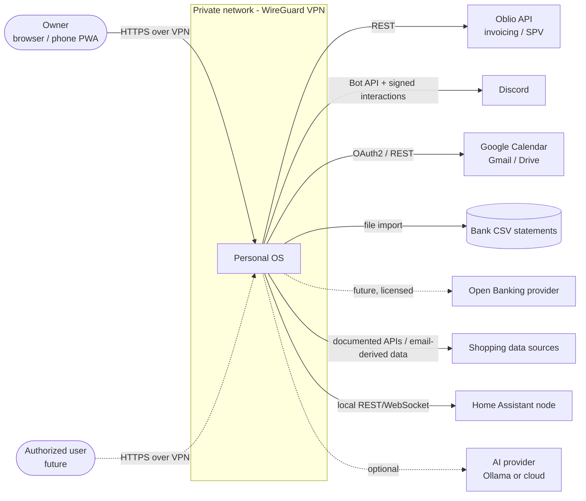
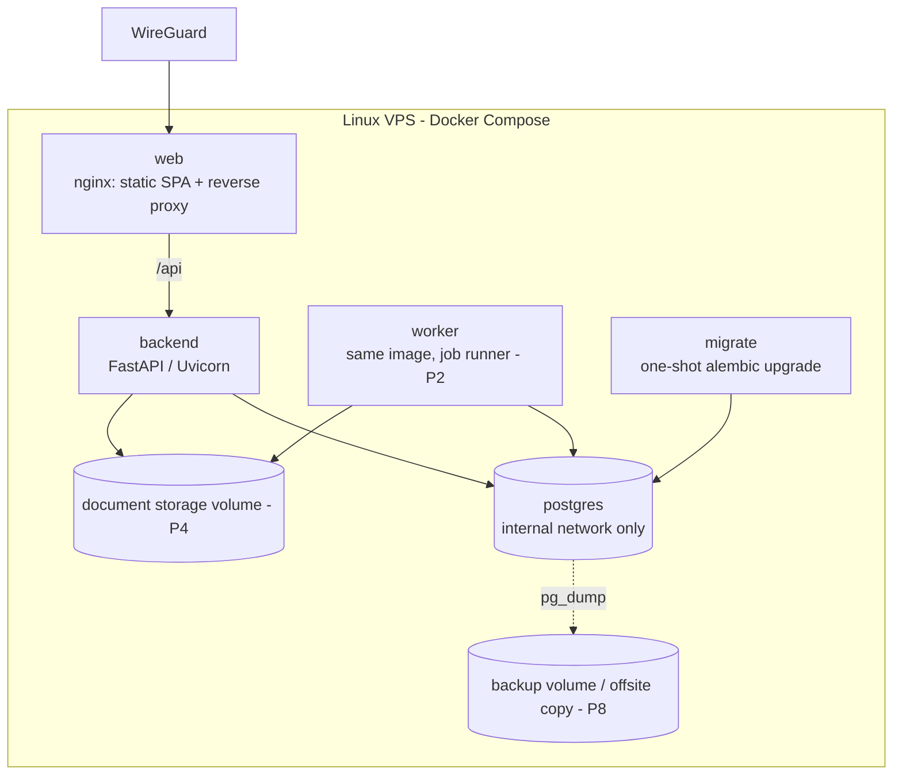
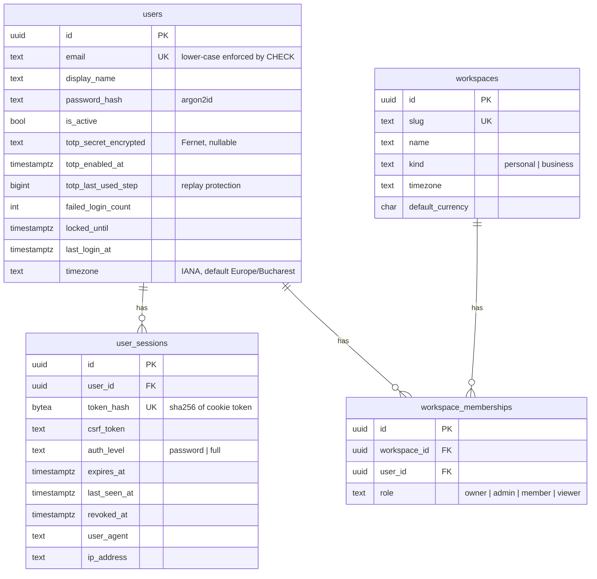
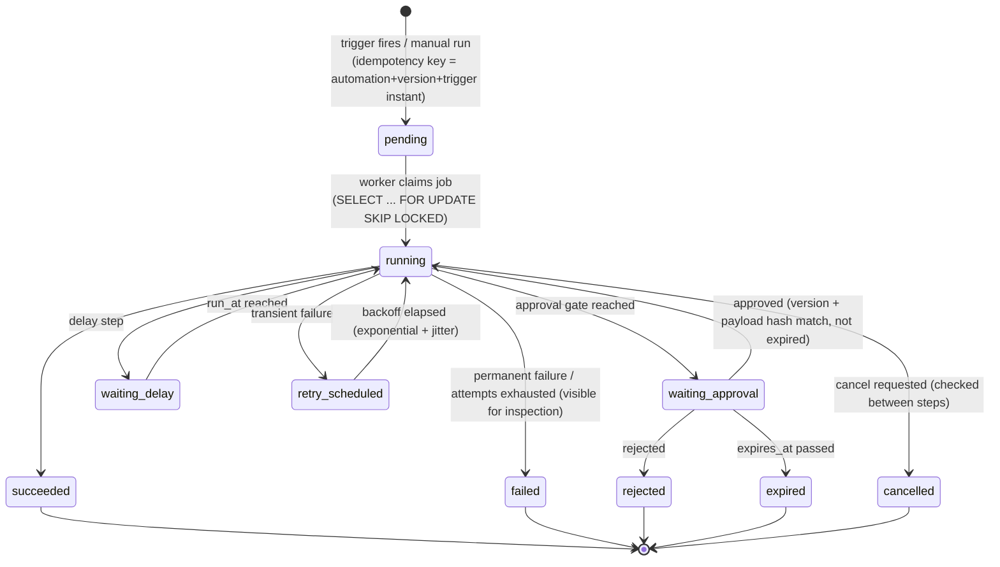

# Personal OS — Architecture

Status: living document. Last updated: 2026-11-08 (Phase 0 + Phase 1 completed).

This document describes the target architecture of Personal OS and the parts
that already exist. Product requirements live in
[PROJECT_SPEC.md](PROJECT_SPEC.md); individual decisions and their tradeoffs
live in [DECISIONS.md](DECISIONS.md); progress is tracked in
[IMPLEMENTATION_PLAN.md](IMPLEMENTATION_PLAN.md).

Legend used below: **[P1]** = implemented in Phase 1, **[Pn]** = planned for phase n.

---

## 1. Requirements summary

| Area | Key requirements | Driving constraints |
|---|---|---|
| Users | 1 primary owner, later a few explicitly authorized users | No public sign-up; strong auth (MFA/passkeys) |
| Data separation | Personal vs. business (Romanian SRL) data | Enforced in every data access path |
| Automation | Durable, idempotent, approvable, auditable workflows | At-least-once processing, never "exactly-once" claims |
| Integrations | Oblio, Discord, Google, banking files, shopping, Home Assistant | Replaceable adapters, mocks when no credentials |
| Money | Invoices, bank transactions, prices | `NUMERIC`/`Decimal` only, explicit currency |
| Time | Schedules, billing periods, reminders | UTC storage + explicit IANA timezones |
| Operations | Single Linux VPS, Docker Compose, private network | Low idle resource usage, no paid services |
| AI | Optional, replaceable, budgeted | Output treated as untrusted input |

### Quality attributes (in priority order)

1. **Security & privacy** — release blocking.
2. **Reliability** — no duplicate invoices, no unapproved side effects.
3. **Maintainability** — module boundaries that survive years of growth.
4. **Low cost** — one VPS, one Postgres, one worker until proven insufficient.
5. **Usability** — a fast, accessible, dark-mode-first command center.

---

## 2. System context



Personal OS is reachable only through the private network. The only inbound
traffic from the public internet is from providers that must call us (Discord
interactions, possibly Google push notifications). Those go to a separate,
minimal, signature-verified webhook entry point [P3].

---

## 3. Containers and deployment



| Container | Image | Purpose | Exposed |
|---|---|---|---|
| `db` | `postgres:17-alpine` | Primary transactional store, also job queue and outbox | Never publicly. Dev: `127.0.0.1` only |
| `migrate` | backend image | Runs `alembic upgrade head` once before the API starts | No |
| `backend` | backend image | HTTP API | Only through `web` in production |
| `worker` [P2] | backend image | Postgres-backed job runner, scheduler, and outbox relay | No |
| `web` | nginx + built SPA (prod) / Vite dev server (dev) | Serves the SPA, proxies `/api` so everything is same-origin | Bound to the VPN interface |

Startup order: `db (healthy) → migrate (completed) → backend (healthy) → web`.
Migrations are never run concurrently by multiple API replicas.

Development uses `compose.yaml` (hot reload, source mounts). Production uses
`compose.prod.yaml` (immutable images, no source mounts, no DB port, restart
policies, log rotation, resource limits).

---

## 4. Backend architecture: modular monolith

### 4.1 Layout

```
backend/app/
  main.py               # composition root: builds the FastAPI app from registered modules
  cli.py                # admin CLI (bootstrap user, workspaces, MFA reset)
  core/                 # framework-level shared kernel, no business logic
    config.py           # pydantic-settings, all env vars
    db.py               # async engine/session, Base, naming conventions
    errors.py           # domain error hierarchy (framework independent)
    http.py             # domain error -> HTTP mapping, error envelope
    logging.py          # JSON logging + secret redaction
    middleware.py       # request id, security headers, origin check
    security/           # passwords, tokens, encryption, TOTP primitives
    module.py           # Module descriptor used by the registry
  modules/
    registry.py         # the only place that lists modules
    system/             # health, readiness, system info
    identity/           # users, sessions, MFA, authentication
    workspaces/         # workspaces, memberships, authorization helpers
    <future modules>/   # automation, approvals, notifications, invoicing, ...
  migrations/           # Alembic (single linear history for the monolith)
```

Each module follows the same internal structure:

| File | Responsibility | May import |
|---|---|---|
| `models.py` | SQLAlchemy ORM tables owned by this module | `core` |
| `schemas.py` | Pydantic request/response models (API contract) | `core`, own `models` |
| `service.py` | Business logic / application services. **No FastAPI imports.** | `core`, own module, other modules' `public` |
| `router.py` | Thin HTTP layer: parse, call service, map result | everything above + FastAPI |
| `dependencies.py` | FastAPI dependencies (auth, sessions) | as router |
| `public.py` | **The module's only public interface** for other modules | own module |
| `module.py` | `Module` descriptor (name, routers, future: event handlers, jobs) | own module |

### 4.2 Dependency rules (enforced by `tests/test_architecture.py`)

1. `app.core` never imports from `app.modules`.
2. A module may import another module **only** through `app.modules.<other>.public`.
3. `service.py` files never import `fastapi` or `starlette` (business logic stays framework-independent).
4. Cross-module foreign keys reference table names (`ForeignKey("users.id")`), not other modules' ORM classes.
5. Only `main.py`, `cli.py`, `modules/registry.py` and `migrations/env.py` (composition roots) may know about all modules.
6. Modules will communicate asynchronously through domain events via the transactional outbox [P2]; synchronous calls go through `public.py` application services.

Adding a new module = create `app/modules/<name>/`, add its `Module` to
`registry.py`, add an Alembic migration. No other module changes.

### 4.3 Request lifecycle

```
nginx -> RequestIdMiddleware -> SecurityHeadersMiddleware -> OriginCheckMiddleware
      -> router (validate with Pydantic) -> dependencies (session, CSRF, workspace access)
      -> service (business rules, explicit transaction commit)
      -> response schema (no ORM objects leak)
Domain errors (core.errors) -> core.http maps to {"error": {"code", "message"}} + status
```

Services own their transactions (`await session.commit()`), which keeps the
unit of work explicit, e.g. a failed login must still persist the failed
attempt counter while returning an error.

### 4.4 Frontend layout

```
frontend/src/
  app/          # App, router (lazy routes), providers
  api/          # openapi-fetch client, generated schema types, query hooks per domain
  components/
    ui/         # design system: button, form controls, overlays (Radix), surfaces, alert
    layout/     # command-center shell: sidebar, Ctrl+K palette, notifications, header
    feedback/   # loading / error / empty / unauthorized / offline states
    data/       # formatting helpers, status chips, key-value views
  features/     # one folder per area: command (neural Command Center), workflows (builder +
                # network), executions, approvals, business, finance, calendar, integrations,
                # settings, auth, placeholders
  stores/       # Zustand: UI state (sidebar, palette), current workspace
  styles/       # globals.css — Tailwind v4 @theme tokens, glass surfaces, React Flow theming
  test/         # Vitest setup and helpers
```

* Stack (ADR-020): Tailwind v4 + Radix primitives in local shadcn-style components, Lucide,
  Motion (reduced-motion aware), Recharts, React Flow. Dark-only.
* Workflow Builder: the saved definition JSON is the single source of truth; `builderModel.ts`
  (typed model, edits, client validation mirroring `automation/definition.py`) and
  `builderGraph.ts` (layout + execution overlay) derive the canvas from it. The server remains
  authoritative for validation.
* Server state → TanStack Query only. Client state → Zustand only when shared (UI shell, current workspace).
* API types are generated from FastAPI's OpenAPI schema (`openapi-typescript`) into `src/api/schema.d.ts`.
* Presentation components never call `fetch` directly; they use hooks from `src/api`.
* Every data view renders explicit loading, error, empty, unauthorized, and offline states.

---

## 5. Module map

| Module | Owns | Phase |
|---|---|---|
| system | health/readiness/info | **P1** |
| identity | users, sessions, MFA (TOTP), passwords; passkeys later | **P1** (passkeys P8) |
| workspaces | workspaces (personal/business), memberships, roles, access checks | **P1** |
| audit | append-only audit records, security events | P2 |
| events | domain events, transactional outbox, subscriptions | P2 |
| jobs | durable job queue, worker, retries, dead-letter inspection | P2 |
| scheduling | cron/interval triggers with IANA timezones | P2 |
| automation | automations, versions, triggers, executions, steps, dry-run | P2 |
| approvals | approval requests bound to version + payload hash, expiry | P2 |
| notifications | channels (in-app, Discord), templates, delivery log | P2 |
| integrations | provider registry, connections, encrypted credentials, health | P2/P3 |
| invoicing | Oblio adapter, invoice drafts, monthly invoice workflow | P3 |
| discord | bot, slash commands, approval interactions | P3 |
| calendar | Google Calendar adapter, reminders, availability | P4 |
| documents | metadata in Postgres, binary in storage backend, Gmail/Drive | P4 |
| banking | CSV statement import, transactions, reconciliation | P5 |
| shopping | products, merchants, price observations, alerts | P5 |
| opportunities | freelance listings, matching | P6 |
| ai | provider interface (disabled/Ollama/cloud), budgets, usage | P6 |
| smarthome | Home Assistant live/mock adapter, discovery/state events, opt-in controls, cooldowns/overrides, durable command log | P7-1/P7-2 implemented (ADR-025) |
| context | location rules, health/lifestyle, shared planning | P7 |

---

## 6. Database schema

Conventions (all tables): UUID primary keys, `created_at`/`updated_at`
`timestamptz` in UTC, explicit constraint naming convention (see
`core/db.py`), money as `NUMERIC(18,4)` + `currency CHAR(3)`, IANA timezone
names stored as text where local-time semantics matter.

### 6.1 Implemented in Phase 1



Unique: `(workspace_id, user_id)` on memberships. Indexes on
`user_sessions(user_id)`, `user_sessions(expires_at)`.

### 6.2 Proposed for later phases (summary)

| Table | Key columns / constraints | Phase |
|---|---|---|
| `audit_records` | actor, workspace_id, action, target, metadata (redacted JSONB), ip; append-only, retention policy | P2 |
| `events` | type, workspace_id, payload JSONB, occurred_at | P2 |
| `outbox_entries` | event_id FK, status, attempts, available_at; index `(status, available_at)` | P2 |
| `jobs` | kind, payload, status, priority, attempts, max_attempts, run_at, locked_by, locked_until, idempotency_key UK, last_error, failure_class | P2 |
| `automations` | workspace_id, name, enabled, current_version_id | P2 |
| `automation_versions` | automation_id, version (UK per automation), definition JSONB (validated typed steps), definition_hash | P2 |
| `automation_triggers` | version_id, kind (manual/cron/interval/event/webhook), config, timezone, next_fire_at | P2 |
| `workflow_executions` | version_id, trigger, status, dry_run, idempotency_key UK, started/finished, cancel_requested | P2 |
| `step_executions` | execution_id, step_key, attempt, status, input/output (redacted), error | P2 |
| `approval_requests` | execution_id, step_key, action_type, payload_hash, version_id, risk_level, status, expires_at, decided_by, decided_via | P2 |
| `notifications` | workspace_id, channel, template, status, dedupe_key UK | P2 |
| `integration_connections` | workspace_id, provider, status, scopes, last_health_check | P2/P3 |
| `integration_credentials` | connection_id, encrypted_blob, key_id, rotated_at, expires_at | P2/P3 |
| `invoices` | workspace_id, provider, provider_series, provider_number, billing_period_start/end, amount NUMERIC, currency, idempotency_key UK, status, spv_status | P3 |
| `documents` / `attachments` | workspace_id, sha256 UK per workspace, mime, storage_key, source | P4 |
| `bank_transactions` | account_id, booking_date, amount NUMERIC, currency, counterparty, import_fingerprint UK | P5 |
| `reconciliation_matches` | transaction_id, document_id/invoice_id, rule, confidence NUMERIC(5,4), status | P5 |
| `merchants`, `products`, `product_listings`, `price_observations` | canonical identity, price NUMERIC, currency, observed_at, in_stock | P5 |
| `opportunity_listings` | source, external_id UK per source, matched_score | P6 |
| `user_preferences` | user_id, key, value JSONB | P2+ |
| `devices`, `device_states` | HA entity id, state, last_changed, command cooldowns | P7 |
| `location_rules` | geofence (coarse), actions | P7 |

Every business table carries `workspace_id`; repository/service queries
always filter by the workspace the caller has been authorized for.

---

## 7. Automation execution lifecycle (target design, Phase 2)



Key guarantees:

* **Durability** — jobs, executions and step state live in Postgres; a worker restart resumes from the last committed step. Jobs whose lease (`locked_until`) expired are re-claimed.
* **At-least-once + idempotency** — each side-effecting step gets a stable idempotency key (`execution_id:step_key`), persisted *before* calling the provider. Providers without native idempotency (e.g. invoice issuance) are guarded by a local unique constraint plus a reconciliation lookup ("does an invoice for this billing period already exist?") before retrying.
* **Approval binding** — an approval stores `automation_version_id` and a SHA-256 hash of the canonical JSON action payload. Execution re-computes the hash; any mismatch or expiry invalidates the approval.
* **Risk policy** — `low` (auto), `medium` (Discord or in-app approval), `high` (in-app approval with fresh MFA). Banking transfers and destructive admin actions are never approvable via Discord alone.
* **Dry-run** — executes conditions and renders action payloads; adapters run in "plan" mode and perform no side effects.
* **Emergency stop** — a global kill switch that halts all side-effecting step types.
* **No arbitrary code** — workflow definitions reference registered, typed action types only.

---

## 8. Integration capability matrix

| Provider | Auth | Capabilities (planned) | Webhooks in | Mock first | Phase |
|---|---|---|---|---|---|
| Oblio | API client id + secret (OAuth2 client credentials token) | clients, products, invoice create/get, email send, SPV status (where offered by API) | No | Yes | P3 |
| Discord | Bot token + interaction public key (Ed25519) | notifications, slash commands, approve/reject buttons | Yes (signed) | Yes | P3 |
| Google Calendar | OAuth2, minimal scopes | list calendars/events, create/update events, free/busy | Optional push | Yes | P4 |
| Gmail | OAuth2, read-only scope where possible | find invoice/receipt emails, fetch attachments | Optional push | Yes | P4 |
| Google Drive | OAuth2, `drive.file` scope | archive documents, accountant folders | No | Yes | P4 |
| Bank statements | none (file upload) | CSV import via pluggable parsers | No | Fixtures | P5 |
| Open Banking | provider-specific (licensed AISP) | interface only until a provider is chosen | — | Interface | P5+ |
| Shopping | per source (manual URL, email-derived, documented APIs) | price observations, stock, history | No | Yes | P5 |
| Home Assistant | long-lived access token, local network | discovery, states, approved services | WebSocket events | Yes | P7 |
| AI | none / local Ollama / optional cloud key | classification, summaries, structured outputs | No | Disabled provider | P6 |

Exact endpoints will be verified against official documentation at
implementation time; nothing in this table is a claim about undocumented
capabilities.

---

## 9. Threat model (STRIDE, summary)

Assets: owner credentials and sessions, provider credentials/OAuth tokens,
invoices and fiscal data, bank statements, documents, location data, the
ability to trigger side effects (issue invoices, control devices).

| Threat | Example | Mitigations | Status |
|---|---|---|---|
| Spoofing | Password guessing / credential stuffing | Argon2id, account lockout after repeated failures, TOTP MFA, VPN-only exposure, no public sign-up | **P1** (rate limiting by IP: P8) |
| Spoofing | Session theft | Random 256-bit tokens, only SHA-256 hash stored, `HttpOnly`+`Secure`+`SameSite=Lax` cookie, idle + absolute expiry, rotation on privilege change, revocation | **P1** |
| Spoofing | Forged Discord approval | Ed25519 signature verification, user/channel allowlist, replay window, high-risk needs in-app MFA | P3 |
| Tampering | CSRF on state-changing endpoints | Per-session CSRF token (header must match), Origin check, JSON-only bodies, SameSite cookies | **P1** |
| Tampering | Approval reused for a changed payload | Approval bound to version + payload hash + expiry | P2 |
| Tampering | Injection (SQL, header, path) | SQLAlchemy parameterized queries, Pydantic validation, no raw SQL from input, safe file names | **P1** baseline |
| Repudiation | "I never approved that" | Append-only audit records with actor, channel, payload hash | P2 |
| Info disclosure | Secrets in logs / frontend | Redacting log filter, credentials never sent to frontend, `.env` never committed | **P1** |
| Info disclosure | Personal ↔ business data leakage | Workspace membership check on every workspace-scoped query; 404 on non-member access | **P1** |
| Info disclosure | DB exposed to internet | DB on internal Docker network, no published port in production | **P1** |
| Info disclosure | Credentials at rest | Fernet (AES-128-CBC + HMAC) with key from env, `MultiFernet` rotation; DB backups encrypted | **P1** (TOTP secrets), P2+ |
| Info disclosure | Sensitive data to AI | AI disabled by default, explicit per-feature consent, redaction | P6 |
| DoS | Runaway automation / toggling devices | Concurrency limits, cooldowns, emergency stop, budgets | P2/P7 |
| Elevation | Member performs owner actions | Role checks per workspace, least privilege | **P1** baseline |
| SSRF | User-supplied URLs (shopping) | Allowlisted schemes/hosts, block private ranges, no redirects to internal IPs | P5 |
| Supply chain | Malicious dependency | Lock files, minimum package age policy, `pip-audit`, `npm audit`, Trivy image scan in CI | **P1** (CI configured) |

---

## 10. Cost assumptions

| Item | Cost | Notes |
|---|---|---|
| VPS (existing) | already paid | Target idle footprint: < 600 MB RAM total (Postgres ~100 MB, API ~120 MB, worker ~120 MB, nginx ~10 MB) |
| PostgreSQL, nginx, Python, Node tooling | free / open source | |
| WireGuard | free | Self-hosted |
| GitHub Actions | free tier | Private repo minutes are limited (2,000 min/month on Free); CI kept lean |
| Oblio API | included with Oblio subscription (existing business cost) | Verify plan includes API access |
| Discord bot | free | |
| Google APIs | free within quotas | OAuth consent screen in "testing"/internal mode for personal use |
| AI | €0 by default (disabled or local Ollama) | Optional cloud provider requires explicit approval and a budget |
| Open Banking aggregator | **potentially paid** | Not used until approved |
| Price data APIs | **potentially paid** | Not used until approved |
| Offsite backups | low (e.g. object storage) | Optional, to be approved in P8 |

---

## 11. Repository structure

```
.
├── backend/                 # FastAPI modular monolith (Python 3.13, uv)
│   ├── app/                 # see §4.1
│   ├── tests/               # pytest: unit, API integration, migrations, architecture rules
│   ├── scripts/             # export_openapi.py (typed client generation)
│   ├── alembic.ini
│   ├── pyproject.toml / uv.lock
│   └── Dockerfile
├── frontend/                # React + Vite + TS strict + MUI
│   ├── src/
│   ├── e2e/                 # Playwright critical flows (run against the compose stack)
│   ├── nginx/               # production nginx config + security headers
│   ├── openapi.json         # exported backend schema (CI checks it is current)
│   ├── package.json / package-lock.json
│   └── Dockerfile
├── infra/
│   └── postgres/init/       # creates the test database in dev
├── docs/                    # spec, architecture, decisions, plan
├── .github/workflows/       # CI and security scanning
├── compose.yaml             # development stack
├── compose.prod.yaml        # production stack
├── .env.example
└── README.md
```

---

## 12. Configuration (environment variables)

All configuration is read by `backend/app/core/config.py` (prefix-free names).
See `.env.example` for a complete, commented list.

| Variable | Required | Default | Purpose |
|---|---|---|---|
| `APP_ENV` | no | `development` | `development` / `test` / `production` |
| `DATABASE_URL` | yes | — | `postgresql+asyncpg://...` |
| `ENCRYPTION_KEYS` | yes | — | Comma-separated Fernet keys; first encrypts, all decrypt (rotation) |
| `ALLOWED_ORIGINS` | yes | `http://localhost:3000` | Allowed browser origins (CORS + Origin check) |
| `SESSION_COOKIE_SECURE` | no | `true` | Must be `true` behind HTTPS |
| `SESSION_IDLE_TIMEOUT_MINUTES` | no | `720` | Idle session timeout |
| `SESSION_ABSOLUTE_TIMEOUT_HOURS` | no | `168` | Absolute session lifetime |
| `AUTH_REQUIRE_MFA` | no | `true` | Force TOTP enrollment before full access |
| `AUTH_MAX_FAILED_LOGINS` | no | `5` | Failed attempts before temporary lockout |
| `AUTH_LOCKOUT_MINUTES` | no | `15` | Lockout duration |
| `LOG_LEVEL` | no | `INFO` | |
| `SESSION_COOKIE_NAME` / `CSRF_COOKIE_NAME` | no | `pos_session` / `pos_csrf` | Cookie names |
| `TEST_DATABASE_URL` | tests | — | Disposable database for pytest (schema is dropped) |
| `POSTGRES_USER` / `POSTGRES_PASSWORD` / `POSTGRES_DB` | compose | — | Credentials for the Postgres container |
| `POSTGRES_HOST_PORT` | dev compose | `5433` | Host port for local tools (127.0.0.1 only) |
| `WEB_BIND_ADDRESS` / `WEB_PORT` | prod compose | `127.0.0.1` / `8080` | Where the `web` container is published |
